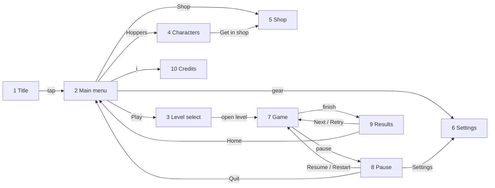

# CS464 Lab 07 · Sky Hop menu system · Mayasa Fakhar · BSCS23069

A complete mobile menu system for **Sky Hop**, my own small platformer: a round little hopper runs across the sky and you tap to jump for coins. It has 10 connected screens, all working in Unity, with eased tweens for every screen change and every important press.

- **Demo video:** https://drive.google.com/file/d/16Hb2DhWvaAoxFqRqMJ2KktU4Bboq42bs/view?usp=sharing (1:18)
- **Unity:** 6000.3.27f1 (Unity 6.3), Input System, TextMesh Pro
- **Scene:** `Assets/Scenes/SkyHop.unity` (the only scene)

## How to run it

1. Open the project folder in Unity Hub with Unity 6000.3.27f1.
2. Open `Assets/Scenes/SkyHop.unity`.
3. In the Game view, pick a portrait phone size, for example **1080x1920 Portrait** (add it with the + in the resolution menu if it isn't there).
4. Press Play. Click to tap. **Esc** works like Android's back button, and **Space** also jumps in the game.

Progress (coins, stars, bought hoppers, settings) is saved with PlayerPrefs. **Settings → Reset progress** (tap it twice) starts again.

## The 10 screens and how they connect

Every inner screen has the same back button in the top-left corner, and Esc (Android back) does the same thing. The Game screen opens Pause instead. Title, Main menu and Results lead forward with their own buttons. No screen is a dead end. A PlayMode test presses the real buttons through all ten screens and checks that each one has at least one working way out.

| Screen | Ways forward | Way back |
|---|---|---|
| 1 Title | tap anywhere → Main menu | (first screen) |
| 2 Main menu | Play, Hoppers, Shop, Settings, Credits | (the hub) |
| 3 Level select | an open level → Game | Back → Main menu |
| 4 Characters | Select, or Get in shop → Shop | Back |
| 5 Shop | Buy, Free gift | Back (to Main menu or Characters) |
| 6 Settings | sliders, switches, Reset | Back (to Main menu or Pause) |
| 7 Game | finish → Results, pause button → Pause | Esc → Pause |
| 8 Pause | Resume, Restart, Settings | Quit to menu |
| 9 Results | Next, Retry | Home → Main menu |
| 10 Credits | (read) | Back → Main menu |

## How it's built

- **One machine for every screen.** `UIManager` keeps a stack of screens, as in Lecture 08. Push goes one level deeper, Back comes one level out, an overlay (Pause, Results) pops up over the screen below, and Home or BackTo jumps back several levels in one slide. Only `UIManager` shows or hides panels and sets `Time.timeScale`. The clock runs only while the Game screen is on top, so every menu and Pause freezes the game.
- **Each screen** is a `UIScreen` with `OnEnter`, `OnResume` and `OnExit`, and fills itself in when it comes in (for example the level grid reads the saved stars).
- **Tweens.** `Tween.cs` is my own small tween helper. Each tween is a coroutine that calls an `Ease` curve every frame, in unscaled time, so menus still animate while the game is paused. A new tween on the same object and channel replaces the old one, so a fast double tap can't make two tweens fight.
- **Input is blocked during a transition** (the root CanvasGroup's `blocksRaycasts` is off until the slide ends), so a double tap can't open two screens.
- **Feedback on every press.** Every button sinks to 92% while held (OutQuad, 0.08 s), springs back with OutBack and makes a sound. The sounds are made in code (`Sfx.cs`), so the project needs no audio files.

### Colour

The palette is deep navy for the menus, with one bright colour per meaning. Hue carries the meaning, and value does the reading.

| Colour | Hex | Meaning |
|---|---|---|
| Navy (3 steps) | `#1C2551` `#26336B` `#34468E` | background, cards, secondary buttons |
| Teal | `#2ED3B7` | the primary action and things you control (Play, Resume, Next, the switches, the default hopper) |
| Gold | `#FFC93C` | rewards: coins, stars, the logo, prices |
| Red | `#D13438` | danger and "no": Quit, Reset, locked, not enough coins |
| Sky and grass | `#5FB4F6` `#4CB86A` | only in the game world, so playing looks different from the menus |

Blue and gold are nearly complementary, so gold rewards stand out on navy. Teal sits next to blue, so the primary buttons belong to the palette and still pop by value. I measured the contrast with the WCAG formula:

| Pair | Ratio |
|---|---|
| White text on the background | 14.7 : 1 |
| Muted text `#AEB8E6` on a card | 6.1 : 1 |
| Navy text on the teal Play button | 8.9 : 1 |
| Navy text on a gold button | 10.9 : 1 |
| White text on the red button | 4.9 : 1 (I darkened the red from `#FF5E5B`, which was only 3.0 : 1) |
| Gold logo on the background | 9.5 : 1 |
| White HUD text on its dark pill over the sky | 16.8 : 1 |

Colour is never the only signal. A locked level also shows a lock, a switch also moves its knob, and "not enough coins" also shakes and shows a message.

### Type

- **Lilita One** is for headings and buttons: a round, chunky display face that fits a cheerful game.
- **Poppins** (Regular and SemiBold) is for body text: a clean geometric sans that stays readable small.
- Sizes go from 210 px (the title logo) down to 30 px (the version line) on a 1080-wide screen. Body text is at least 32 px.

### Layout, touch and responsiveness

- **Canvas Scaler:** Scale With Screen Size, reference 1080 × 1920, match 0.5. Everything is anchored to its edge: top bars to the top, the main buttons to the bottom, content to the centre. Taller and wider phones then just get more space between the groups.
- **SafeArea.cs** fits all the buttons and text inside `Screen.safeArea`, so nothing sits under a notch or the home bar. The backgrounds stay outside it and still fill the whole screen.
- **Touch targets:** every button is at least 130 × 130 px, about 8 mm on a typical phone. That is above Android's 48 dp (about 7.6 mm). A switch toggles from anywhere on its 860 × 150 row, and a slider can be grabbed anywhere on its 440 × 100 track. The main actions sit in the bottom half, where the thumb reaches.
- **Consistency:** one button style for each level of importance (teal primary, navy secondary, gold for spending, red for danger). Every button has a darker lip under it so it looks pressable, and the back button is in the same corner on every inner screen.

### Greyscale check

For each screen I saved the colour screenshot (`NN-name-colour.png`) and a greyscale copy beside it (`NN-name-greyscale.png`), converted by luminance (the same as GIMP's Colors > Desaturate > Luminance). Then I checked that headings, body text, buttons, backgrounds, and the selected and disabled states were still apart without hue.

The check found two real problems, and I fixed both with a non-colour cue rather than by changing hue:

- **Danger buttons** (Quit to menu, Reset progress): the red and the navy buttons were nearly the same grey. Every danger button now has a light outline.
- **Coins in the game:** the gold coins disappeared into the light sky. Each coin now sits on a dark disc.

I took the screenshots again after the fixes. Each screen's section below has its annotated colour image, the colour original, the greyscale copy and one line on what the check found.

### Motion

Each ease is chosen for what the motion has to say:

| Ease | Used for | Why |
|---|---|---|
| OutCubic | a screen sliding in, counters counting up | arrives fast and settles: the eye lands on the result |
| InCubic / InQuad | a screen or card leaving | leaves fast, so it's out of the way |
| InOutQuad | the old screen stepping back, the switch knob | moves between two resting places |
| OutBack | overlays, staggered buttons, stars, badges | overshoots a little: "this is new, look here" |
| InBack | an overlay closing | pulls back before it goes |
| OutBounce | the logo on the title | playful, sets the tone |
| InOutSine | idle floats and the "tap to start" pulse | slow and calm, never distracting |
| Shake (damped sine) | locked level, not enough coins, reset asks again | the "no" gesture |
| Punch | the coin counter when something changes | "this number just changed" |
| Linear | the credits roll | an even reading speed, so no easing on purpose |

**Settings → Reduce motion** turns every menu tween into a short 0.12 s ease with no overshoot, bounce or shake, for players who don't like movement.

---

## 1. Title

| Colour | Greyscale |
|---|---|
|  |  |

**Greyscale check:** No change needed. The logo is the lightest and largest shape, the prompt is white on dark, and the hopper stays a mid grey with its dark face.

**Purpose:** the first impression: the game's name, its hero and one clear thing to do.

**Principles and techniques:** a strong hierarchy (logo, then hopper, then prompt, then the tiny version line). The whole screen is the button, the biggest possible touch target. Gold on navy is 9.5:1, and the hero is teal, the "you control this" colour.

**Tweens:**
- The logo drops in with **OutBounce** (0.9 s). It's playful and gives the game its tone.
- The hopper pops in with **OutBack** (0.45 s, after 0.6 s), then floats on **InOutSine**.
- "Tap to start" fades in last (after 1 s) and breathes. It shows up only when the screen is ready, so you know what to do.
- Going to the main menu is a **cross-fade with a slight zoom** (1.06 to 1, OutCubic), because they are the same level, not deeper.

## 2. Main menu

| Colour | Greyscale |
|---|---|
|  |  |

**Greyscale check:** No change needed. Play turns light grey with dark text and stands well apart from the dark-grey secondary buttons; the pills keep light numbers on dark.

**Purpose:** the hub. Play is one tap away, and so is everything else.

**Principles and techniques:**
- Play is the biggest and brightest button, in the thumb zone (Fitts's law: big and close).
- The secondary actions (Hoppers, Shop) are grouped in a row under it.
- The utilities (credits, settings) are small icons in the corner.
- Coins and stars are grouped top-left in matching pills.
- The hopper shown is the one you picked, so the screen reflects your choices.

**Tweens:**
- The five buttons pop in **staggered with OutBack**, 60 ms apart, Play first, so the eye follows them in order of importance.
- The coin and star pills **count with OutCubic and Punch** whenever the number changes.
- Every button opens its screen with the **push slide** shown above.

## 3. Level select

| Colour | Greyscale |
|---|---|
|  |  |

**Greyscale check:** No change needed. Open tiles are a mid grey and locked tiles are darker, and locked ones also have a lock instead of a number. Earned stars are light, missing ones faint.

**Purpose:** choose one of 12 levels and see your progress.

**Principles and techniques:**
- A 3 × 4 grid with equal tiles and gaps, aligned to the centre line.
- Open levels show their number and stars (gold for earned, faint for missing).
- Locked levels are darker and show a lock instead of a number. The lock shape tells you as well as the colour.
- A hint line explains the rule, and the star total sits top-right.

**Tweens:**
- The tiles pop in **one by one in reading order** (OutBack, 35 ms apart).
- Tapping a locked tile plays a **Shake** and a buzz, and a toast says which level to finish first: feedback that says *why*.

## 4. Characters

| Colour | Greyscale |
|---|---|
|  |  |

**Greyscale check:** No change needed. The current page dot is lighter and also bigger; the locked badge has a lock icon and the price, not just its red.

**Purpose:** browse the five hoppers and pick one to play as.

**Principles and techniques:**
- One card at a time, with the picture, the name (heading font) and a muted blurb.
- Large arrows sit at both edges for the thumbs, and page dots show where you are.
- A red badge with a lock and the price marks a hopper you don't own yet.
- The action button's label changes with the state: Select, Selected, or Get in shop. "Get in shop" leads to the Shop, which connects the two screens logically.

**Tweens:**
- Changing hopper slides the card out the way you pressed (**InQuad**, 0.14 s, fast exit) and the next one in from the other side (**OutCubic**, 0.26 s). The direction matches the arrow.
- The current dot grows with **OutQuad**.
- Selecting pops the teal tick with **OutBack** and plays a sound, confirming the choice where you were looking.

## 5. Shop

| Colour | Greyscale |
|---|---|
|  |  |

**Greyscale check:** No change needed. The gold buy buttons are light with dark text, and Owned has a tick and a word. The red flash on the coin counter is faint in grey, but the shake and the toast carry the same message.

**Purpose:** spend coins on new hoppers, and collect a free gift once.

**Principles and techniques:**
- The gift is first and in gold.
- Each row is the hopper, its name and a gold buy button with the price on it, so the price is the thing you press (affordance).
- Owned rows swap the button for a teal "Owned" badge.
- The coin balance is in the top-right.

**Tweens:**
- Rows pop in staggered with **OutBack**.
- **Buying:** the coin counter counts down with **OutCubic**, the "Owned" badge pops with **OutBack**, a happy arpeggio plays, and a toast says to pick the hopper in Characters.
- **Not enough coins:** the button **shakes**, the counter flashes red and shakes, and a toast says how many coins are missing. The screenshot shows that moment.

## 6. Settings

| Colour | Greyscale |
|---|---|
|  |  |

**Greyscale check:** **Changed.** In greyscale the red Reset button was nearly the same grey as the navy buttons, so every danger button now has a light outline (a non-colour cue). The switches already read by knob position: right and light means on.

**Purpose:** sound volume, vibration, reduce motion and resetting progress. It opens from the main menu and from Pause, and Back returns to whichever one opened it.

**Principles and techniques:**
- The settings are grouped on cards with small-caps headings, and each row is an icon, a label and its control, aligned in two columns.
- The sliders have 80 px handles.
- The switches show on and off by knob position as well as colour, and the whole row is the tap target.
- The destructive Reset is red and alone at the bottom, away from the other settings, and it asks again before acting.

**Tweens:**
- The groups pop in staggered (**OutBack**).
- The switch knob slides with **InOutQuad** (0.22 s) while the track blends from navy to teal.
- The first tap on Reset turns it darker red, **shakes** it and changes the label to "Tap again to reset". After 3 s with no second tap it goes back.

## 7. Game (HUD)

| Colour | Greyscale |
|---|---|
|  |  |

**Greyscale check:** **Changed.** The gold coins and the light sky turned the same grey, so the coins almost vanished. Each coin now sits on a dark navy disc, which shows as a dark ring on the light sky.

**Purpose:** the game itself, small but playable. The hopper runs by itself, and a tap anywhere makes it jump. Ground coins are free, air coins need a jump, and the share you collect decides 1 to 3 stars. It is there so Pause and Results have a real game to sit on.

**Principles and techniques:**
- The world is bright sky and grass, unlike the dark menus, so "playing" looks different from "choosing".
- The HUD stays at the edges on dark pills (16.8:1), and the middle is clear for the action.
- Pause is top-right in the same style as the menu buttons.
- The gold progress bar shows how far is left.

**Tweens:**
- A "Ready?" / "Go!" banner pops with **OutBack**.
- The hopper stretches on take-off and squashes on landing (**OutBack** back to round).
- A collected coin scales up and vanishes, and the counter **punches**.
- These run on the game clock, so Pause freezes them mid-move.

## 8. Pause

| Colour | Greyscale |
|---|---|
|  |  |

**Greyscale check:** **Changed.** Quit to menu merged with Restart and Settings into one grey. It now has the light outline of the danger style, as well as being shorter, last and set apart.

**Purpose:** stop the game and choose to resume, restart, change settings or quit.

**Principles and techniques:**
- An overlay: the frozen game stays visible behind a dim, so you know where you'll go back to.
- The buttons are ordered by how likely you are to want them: Resume (biggest, teal), then Restart and Settings (navy), then Quit (red, shortest, with a gap above it, so it's never hit by accident).

**Tweens:**
- The dim fades in (**OutQuad**, 0.2 s), and the card pops from 80% with **OutBack** (0.3 s). That reads as "on top of the game", not a new place.
- The buttons stagger in after the card.
- Closing reverses it with **InBack**, and the game clock starts again.

## 9. Results

| Colour | Greyscale |
|---|---|
|  |  |

**Greyscale check:** No change needed. Earned stars are light and the missing star dark; Next is light against the two dark icon buttons; the New best! badge keeps white text on mid grey.

**Purpose:** show how the level went (stars, coins, a new best) and offer the next step.

**Principles and techniques:**
- The stars are the biggest thing on the card, and the middle star is bigger and higher.
- Next is the primary action (teal, widest, on the right under the thumb). Home and Retry are small icon buttons.
- On the last level, Next becomes "Levels".

**Tweens:**
- The stars land **one by one** (OutBack, 0.3 s apart), each with a rising note.
- The coins **count up with OutCubic** (0.8 s).
- "New best!" pops in last, only when you beat your record.
- The buttons arrive after the celebration, so the result is seen first.

## 10. Credits

| Colour | Greyscale |
|---|---|
|  |  |

**Greyscale check:** No change needed. Section labels are a lighter muted grey and smaller than the white names, so the grouping survives without colour.

**Purpose:** say who made the game, and credit the fonts and the games that inspired the menus.

**Principles and techniques:** the same header and back button as every inner screen. Each section has a muted label and white names, centred, and a mask keeps the text inside its frame.

**Tweens:** the text rolls up at a steady 70 px/s with **Linear** motion, on purpose: credits are read, and an even speed is easiest to read. Holding a finger on the list stops it.

---

## Tests

`Assets/Tests` isn't in the repo, but I ran two PlayMode tests on the final version:

- **All ten screens connect with no dead ends.** The test presses the real buttons: Title, Main menu, Level select and back, then Characters. A locked hopper goes to the Shop: buying Berry (150) works, buying Mint (250) is refused with nothing spent, and the gift adds 100. Then it selects Berry, opens Settings and Credits, and taps a locked level (stays put). Level 1 starts the game (timeScale 1). Then it tests Pause (timeScale 0), Settings from Pause and back, Resume, playing to the end, Results, Next to level 2, and Quit to the main menu. Every screen had at least one working button, and all 10 were visited.
- **Screenshots for this document.** The same flow, capturing each screen at 1080 × 1920.

## Credits and references

- **Design, code, layout and sprites:** Mayasa Fakhar. Every icon, the hopper and the backgrounds were drawn in code with Python (Pillow). No AI-generated images.
- **Fonts:** [Lilita One](https://fonts.google.com/specimen/Lilita+One) by Juan Montoreano and [Poppins](https://fonts.google.com/specimen/Poppins) by Indian Type Foundry, both under the SIL Open Font License. The licences are in `Assets/Fonts`.
- **Sound:** made in code at runtime (`Sfx.cs`).
- **TextMesh Pro Essential Resources** (in `Assets/TextMesh Pro`): Unity's own package, including its LiberationSans font.
- **Inspiration:**
  - *Crossy Road* (Hipster Whale): the one-character-at-a-time carousel.
  - *Cut the Rope* (ZeptoLab): the level grid with stars and locks.
  - *Alto's Adventure* (Snowman): the calm pause and settings cards.
  - Nothing was copied from them, only the ideas.
- **Course:** CS464 Lecture 08 (colour, UI and menus: HSV, harmonies, contrast, Fitts's law, Canvas anchors, one state machine for every screen, pausing properly) and the easing lab.
