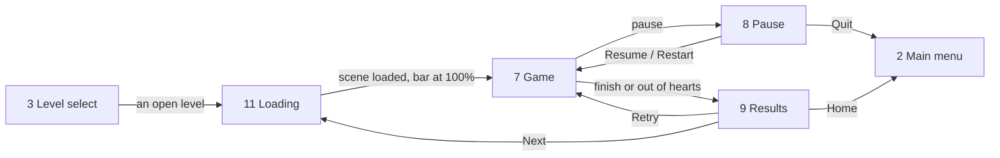
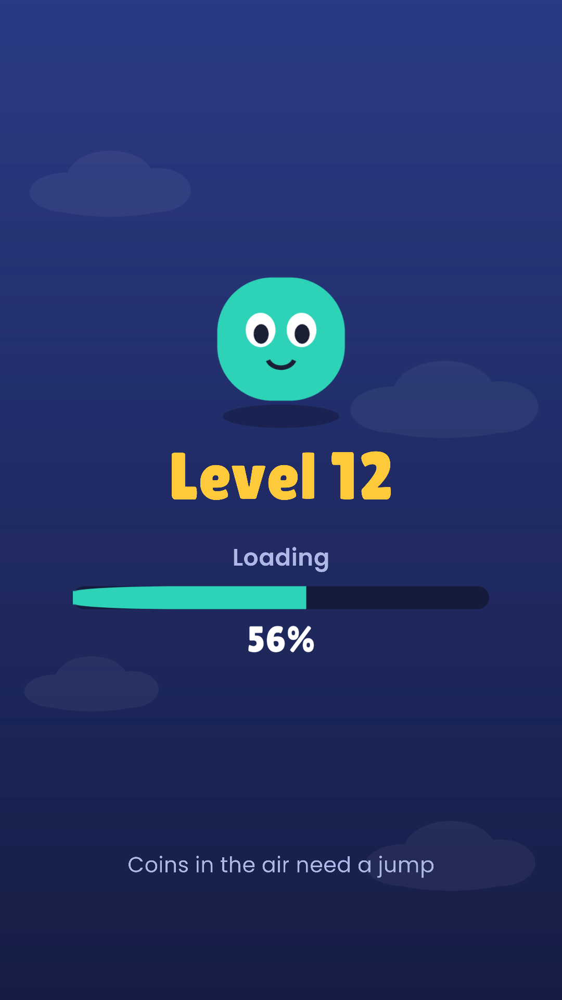
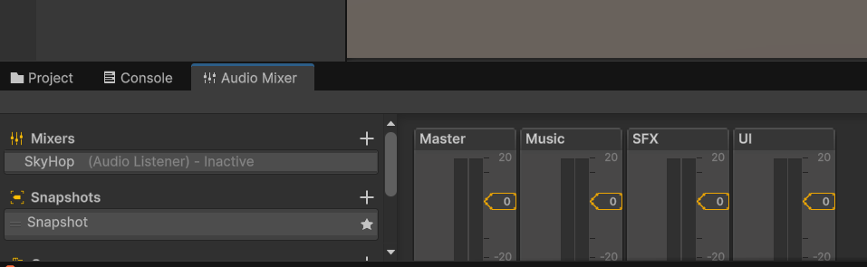
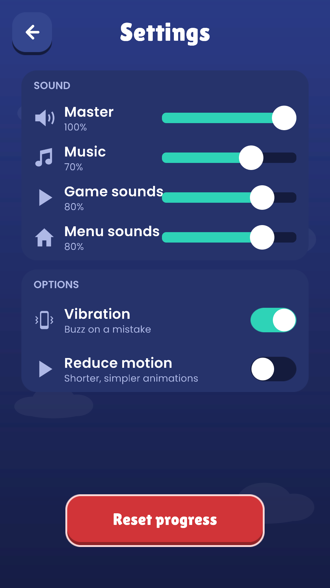
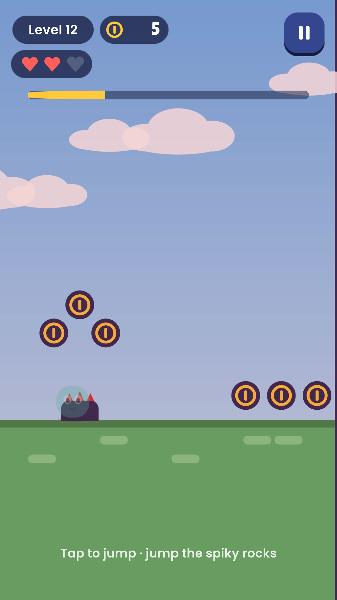
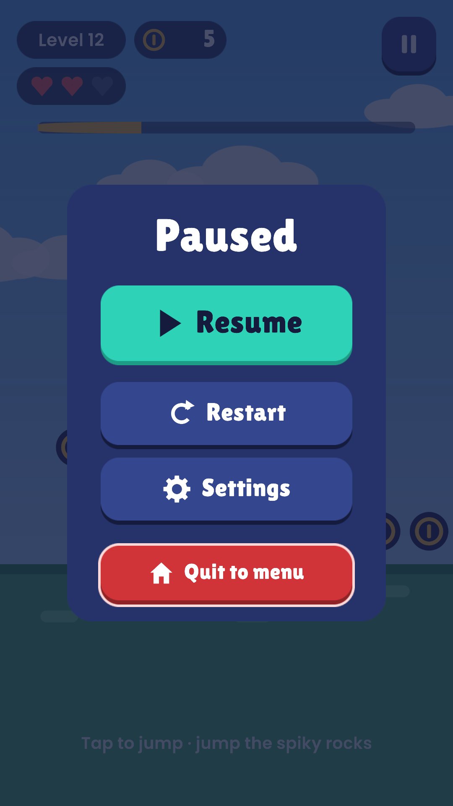
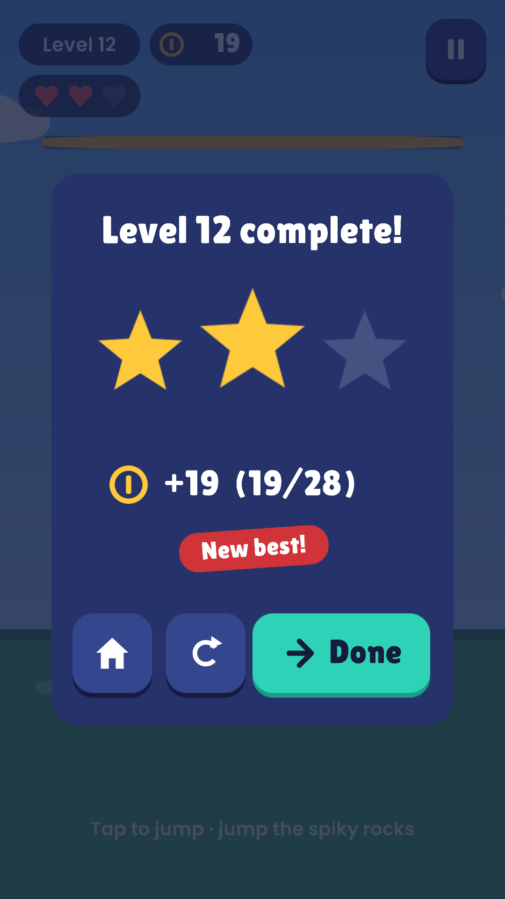
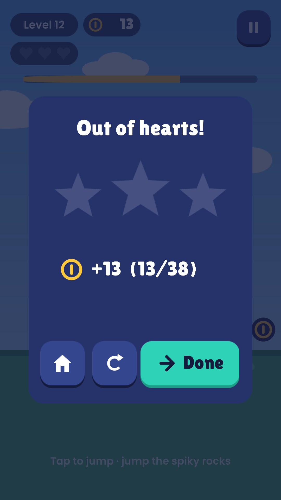

# CS464 Lab 08 · Sky Hop: loading, sound and events · Mayasa Fakhar · BSCS23069

For Lab 08 I built on my Lab 07 project, **Sky Hop**: a round little hopper runs across the sky, and you tap to jump for coins. All ten Lab 07 screens still work the same way, with the same tweens and the same phone layout. On top of them I added:

- a real **Gameplay scene**, loaded in the background behind a new **Loading** screen (screen 11);
- **sound**: 14 UI sounds, 8 game sounds and two music loops, all going through **one Audio Mixer** with **four volume sliders**;
- **C# events**: the run raises events and eight separate components react to them;
- **rocks and three hearts**, so the game can hurt you and you can lose. That gives the events something real to say.

| | |
|---|---|
| **Demo video** | https://drive.google.com/file/d/16FBRdxzlyliHA7Qz_L79z-Ur9PL07OH3/view?usp=sharing (1:32) |
| **Unity** | 6000.3.27f1 (Unity 6.3), Input System, TextMesh Pro |
| **Scenes** (Build Profiles → Scene List) | 0 `Assets/Scenes/SkyHop.unity`: the menus, the HUD and the audio · 1 `Assets/Scenes/Gameplay.unity`: the run |
| **Lab 07 design document** | [Docs/LAB07.md](Docs/LAB07.md): the 10 screens, colour, type, layout and motion |

## How to run it

1. Open the project folder in Unity Hub with Unity 6000.3.27f1. If Unity Hub isn't signed in, the Package Manager may say "error searching packages". That's harmless: every package the project needs is already in it.
2. Open `Assets/Scenes/SkyHop.unity`. If you open `Gameplay.unity` and press Play instead, it switches to `SkyHop` by itself, because the game has to be loaded from the menu.
3. In the Game view, pick a portrait size such as **1080x1920 Portrait**, and make sure **Mute Audio** is off.
4. Press Play. A click is a tap, **Space** also jumps, and **Esc** is the back button (in the game it pauses).

## 1. Loading



- **Additive loading.** `SkyHop` stays loaded the whole time, and `Gameplay` is loaded on top of it with `LoadSceneMode.Additive`. The menus, the HUD, the mixer and the music player never reload, so the music can crossfade instead of restarting. The game world is drawn on its own canvas (sort order 0), under the menu canvas (sort order 10).
- **`UIManager.LoadLevel(level)`** removes everything above the level grid, such as an old game and its Results, and fades in the Loading screen.
- **`LoadingScreen`** does the loading:
  1. If a Gameplay scene is still loaded (Next from Results), it unloads it first.
  2. It calls `SceneManager.LoadSceneAsync("Gameplay", LoadSceneMode.Additive)` with `allowSceneActivation = false`.
  3. Every frame it shows the real progress as a bar and a percentage. Unity's progress stops at 0.9 while it waits to switch the scene on, so `op.progress / 0.9` is the "loaded" fraction.
  4. When the bar reaches 100%, it allows activation and waits for `isDone`. Only then does it open the Game screen.
- **You can't get into the game early.** The test checks every frame of the load: the bar never goes backwards, the run doesn't exist before the bar is full, and the Game screen opens only at 100%.
- **The bar has a minimum time.** My Gameplay scene is small, so it loads in a few frames. The bar shows `min(real progress, time / 0.9 s)`, so it takes at least 0.9 s and can be read. It never shows more than what has really loaded.
- **No back button while loading.** Esc does nothing on the Loading screen, because there is nothing to go back to in the middle of a load. Leaving the game (Quit, Home, or Next on the last level) unloads the Gameplay scene.



## 2. The Audio Mixer



`Assets/Audio/SkyHop.mixer` has one Master group with three groups under it. Each group's volume is exposed so that a slider can set it:

| Group | Exposed parameter | AudioSources routed to it | Played by |
|---|---|---|---|
| Master | `MasterVolume` | (the other three) | |
| Music | `MusicVolume` | Music Source A, Music Source B | `MusicPlayer` (menu scene) |
| SFX | `SfxVolume` | SFX Voice 1–4 · SFX Preview Source | `GameSounds` (Gameplay scene) · `UiSounds` (so the SFX slider can be heard in the menus) |
| UI | `UiVolume` | UI Source | `UiSounds` (menu scene) |

There are 8 AudioSources in the whole game, and every one has its output group set. No button has its own AudioSource: every button and panel plays through the single `UiSounds` player. A test lists every AudioSource with both scenes loaded and checks its group. It also checks that there is exactly one AudioListener (on the camera in `SkyHop`).

The mixer's **Update Mode is Unscaled Time**, because the menus and Pause run at `timeScale` 0.

## 3. Volume sliders

Settings now has four sliders, one per group: **Master, Music, Game sounds (SFX) and Menu sounds (UI)**. Each has a `VolumeSlider` component.

- **Logarithmic mapping.** The slider gives 0 to 1, and `VolumeSettings.ToDecibels` turns that into decibels with `20 · log10(v)`. We hear loudness on a log scale, so this makes the middle of the slider sound like the middle. A linear mapping would put almost all the change in the last bit of the slider.

  | Slider | 1 | 0.5 | 0.25 | 0.0001 or 0 |
  |---|---|---|---|---|
  | Mixer | 0 dB | −6.02 dB | −12.04 dB | −80 dB (muted, shows "Off") |

- **Safe mute.** `log10(0)` is minus infinity, so anything at or below 0.0001 is set to −80 dB, the mixer's floor, and the row says **Off** instead of a percentage.
- **Saved with PlayerPrefs.** The keys are the parameter names (`MasterVolume`, `MusicVolume`, `SfxVolume`, `UiVolume`). The defaults are 100%, 70%, 100% and 80%. A value is saved when you let go of the slider and when you leave Settings.
- **Put back on start.** `VolumeSettings.Start` applies all four saved values. It does this in Start, not Awake, because `AudioMixer.SetFloat` doesn't stick in Awake. A test sets the sliders, resets the mixer to 0 dB, loads the scene again, and checks that the saved decibels come back.
- **Hear it while you drag.** Dragging plays a short sample of that group: a click for Master and Menu sounds, a coin for Game sounds. Music is already playing.
- **Reset progress** still clears coins, stars and hoppers, but now keeps the sound settings and the two switches.



## 4. What plays while paused

`UIManager.AfterMove()` runs after every screen change and decides the clock and the audio from the screen on top:

| While paused (Pause, or Settings opened from Pause) | What happens | How |
|---|---|---|
| The game (hopper, rocks, coins, sparks, blinking) | frozen | `Time.timeScale = 0` |
| Game sounds (SFX) | paused, and they carry on from where they stopped on Resume | `AudioListener.pause = true`. The SFX voices don't ignore it |
| Music | keeps playing at 40% volume, so the pause feels calm, not broken | the music sources have `ignoreListenerPause`, and `MusicPlayer` ducks them over 0.35 s |
| UI sounds | keep working, so the pause menu still clicks | the UI source has `ignoreListenerPause` |

Results is not a pause. The finish or "ouch" sound plays to its end, and the music crossfades back to the menu track. Restarting a run stops any game sound still ringing from the last one.

## 5. Music and the crossfade

There are two loops, each an exact number of bars so it repeats with no gap:

- **Menu:** 92 bpm, a soft arpeggio over a pad (C, Am, F, G), 20.9 s.
- **Game:** 132 bpm, kick, hi-hats, bass and a bouncy lead, 14.5 s.

`MusicPlayer` has two AudioSources on the Music group. To change track, it starts the new loop on the free source and crossfades over 1.2 s with an **equal-power** curve: the new one rises on a sine while the old one falls on a cosine, so the loudness doesn't dip in the middle.

| When | Music |
|---|---|
| Title, menus, Loading | menu loop |
| The Game screen opens after loading | crossfade **menu → game** |
| Pause or Settings from Pause | game loop, ducked to 40% |
| Results (won or lost) | crossfade **game → menu** |
| Retry from Results | crossfade **menu → game** |
| Quit to menu | crossfade **game → menu** |

## 6. Sounds

All sounds play with `PlayOneShot`, so quick ones overlap instead of cutting each other off.

**UI sounds** (UI group, through `UiSounds`):

| Moment | Sound |
|---|---|
| Pointing at a button with a mouse | a very soft tick. A phone has no hover, so touches don't play it |
| Pressing a button | a short rising click |
| Back / cancel | a short falling click |
| A screen sliding in or out | a soft whoosh |
| A card opening / closing (Results) | a rising / falling pop |
| Pause / Resume | two notes down / two notes up |
| Not allowed (a locked level, not enough coins, Reset asking again) | a low buzz |
| Success: buying a hopper, the free gift, each star landing | a rising arpeggio, a coin chime, a three-note chime |
| Level complete / out of hearts | a short fanfare / a falling "aw" |

**Game sounds** (SFX group, through `GameSounds` in the Gameplay scene):

| Event | Sound | Pitch variation |
|---|---|---|
| Ready? / Go! | two beeps | none: they're signals |
| Jump | a rising chirp | ±1 semitone at random |
| Land | a soft thud | ±1 semitone |
| Coin | a bright two-note ding | climbs a semitone for each coin picked up within 0.5 s of the last (up to +7), ±0.3 at random |
| Hit a rock | a crunch | ±0.5 semitone |
| Out of hearts | a falling wobble | none |
| Finish | a short fanfare | none |

`GameSounds` takes its four SFX voices in turn, so changing the pitch for one sound doesn't change a sound that is still playing on another voice.

## 7. C# events

**The publisher is `RunController`** (in the Gameplay scene). It runs the hopper, the coins, the rocks and the rules. It doesn't play sounds, update the HUD or shake anything. When something happens, it raises an event:

| Event | Raised when | Listeners |
|---|---|---|
| `Prepared(int level)` | a run is laid out | `HudCoins`, `HudHearts`, `GameSounds`, `HopperFeedback` |
| `Started()` | "Go!" | `GameSounds` |
| `Jumped()` / `Landed()` | take-off / touch-down | `GameSounds`, `HopperFeedback` |
| `CoinCollected(int count, Vector2 at)` | a coin is picked up | `HudCoins` (counter + Punch), `GameSounds` (ding), `CoinBurst` (gold sparks) |
| `Damaged(int hearts, int max)` | the hopper hits a rock | `HudHearts` (a heart goes dark and pops), `HitFlash` (red screen flash), `GameSounds` (crunch), `HopperFeedback` (blinks while it can't be hurt), `WorldShake` (the world shakes) |
| `Died()` | the last heart goes | `GameScreen` ("Ouch!", then Results), `GameSounds`, `WorldShake` |
| `Won(RunResult)` | the end of the level | `GameScreen` ("Finish!", then Results), `GameSounds` |

That is eight separate listener components, and none of them knows about the others. Four live in the Gameplay scene with the run, and four are part of the HUD in the menu scene. The HUD ones find the run through `RunController.Current` when the Game screen opens, which only happens after the scene has loaded. Every listener subscribes with `+=` in `OnEnable` and unsubscribes with `-=` in `OnDisable`. Every event is raised with `?.Invoke(...)`, so an event with no listeners is safe.

**One event, from declaration to listener:**

```csharp
// RunController.cs: the publisher
public event Action<int, int> Damaged;           // hearts left, most hearts

void HitRocks()
{
    ...
    Hearts--;
    safeUntil = time + SafeAfterHit;
    Damaged?.Invoke(Hearts, MaxHearts);
    if (Hearts <= 0)
    {
        running = false;
        Died?.Invoke();
    }
}
```

```csharp
// HudHearts.cs: one of the five listeners
void OnEnable()
{
    run = RunController.Current;
    if (run == null) return;
    run.Prepared += OnPrepared;
    run.Damaged += OnDamaged;
}

void OnDisable()
{
    if (run == null) return;
    run.Prepared -= OnPrepared;
    run.Damaged -= OnDamaged;
    run = null;
}
```

A test counts the listeners on the live run:
- `Damaged` has 5, `CoinCollected` has 3 and `Won` has 2.
- One real hit darkens the third heart and flashes the screen.
- The moment you quit, the HUD's listeners let go and only the Gameplay scene's own 3 are left. Then the run is destroyed with its scene.

## 8. Changes to the game

- **Rocks.** Rocks with red spikes sit under some of the coin arcs. The first arc of a level never has one, the second always does, and later ones are more likely in later levels. Jumping for the coins clears the rock, so there's a reason to jump. From Level 2, a lone rock also sits in the gap after each arc, with room to land and jump again. Level 1 has 2 rocks, and every later level has 3 to 7, so from Level 2 on you can lose all three hearts.
- **Three hearts** in the HUD. A hit costs one and gives 1.2 s when you can't be hurt again (the hopper blinks).
- **Losing.** With no hearts left, the run ends: "Ouch!", then Results says **Out of hearts!**. You get no stars, but you keep the coins you picked up. Retry comes first, and Next only shows if the next level was already open.
- **The HUD** is the Game screen in `SkyHop`. The world (sky, ground, coins, rocks, hopper) is in `Gameplay`. A tap anywhere on the HUD jumps.
- On the last level, Results' Next button now says **Done**: "Levels" didn't fit on the button.

| Hit: flash, a dark heart, the hopper blinking | Pause over the game | Level complete | Out of hearts |
|---|---|---|---|
|  |  |  |  |

## Tests

The tests (`Assets/Tests`) aren't in the repo, but I ran five PlayMode tests on the final version. Each one fails on any error in the Console.

1. **Full flow, with no dead ends.** The test presses the real buttons:
   - Title and Main menu, then Characters, buying in the Shop, Settings (4 sliders) and Credits.
   - A locked level, then Level 1 through Loading, checked frame by frame.
   - Every AudioSource and its group, and one AudioListener.
   - Pause: game sounds paused, music ducked and still playing. Then Settings from Pause, and Resume.
   - Playing to the end, Results (music back to the menu track), Next through Loading into a fresh Level 2.
   - Quit: the Gameplay scene unloads, the menu music plays, and nothing is left paused.
   - All 11 screens were visited.
2. **Run events reach independent listeners**, as in section 7.
3. **Three hits lose the run.** Level 12 is played without jumping: 3 Damaged events, 1 Died event, "Out of hearts!", 0 stars. Retry starts again with full hearts.
4. **Volumes are decibels and survive a restart**, as in section 3. Reset progress keeps them.
5. **Screenshots for this README.**

Before handing in, I also cloned the repository into a different folder and checked that it opens, compiles, loads the game and plays the sounds through the mixer.

## Credits

- **Sound and music:** I made every sound effect and both music loops for this game. They are synthesised in Python with numpy from sine, triangle and square waves and filtered noise, and saved as WAV files in `Assets/Audio`. There is **no third-party audio** in the project.
- **Fonts:** [Lilita One](https://fonts.google.com/specimen/Lilita+One) by Juan Montoreano and [Poppins](https://fonts.google.com/specimen/Poppins) by Indian Type Foundry, both under the SIL Open Font License (the licences are in `Assets/Fonts`).
- **Sprites and icons:** drawn in code with Python (Pillow) for this project, including the new Rock and Spikes sprites.
- **TextMesh Pro Essential Resources:** Unity's own package.
- **Course:** CS464 Lecture 09 (loading scenes asynchronously, AudioSources and the Audio Mixer, decibels, PlayOneShot and pitch variation, pausing audio, C# events) and Lecture 08 for the menu system it builds on.
